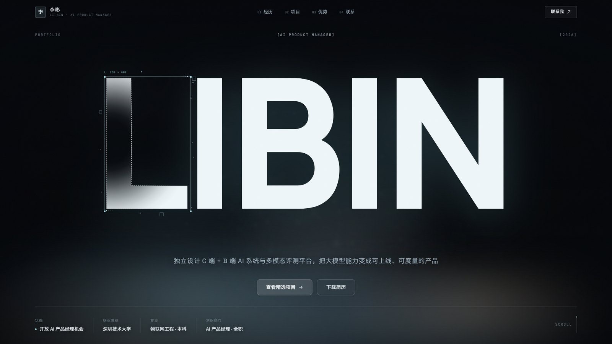
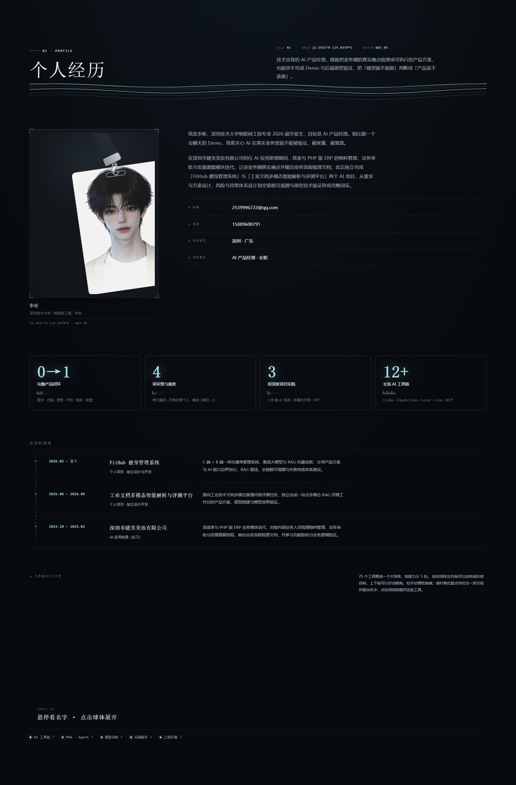
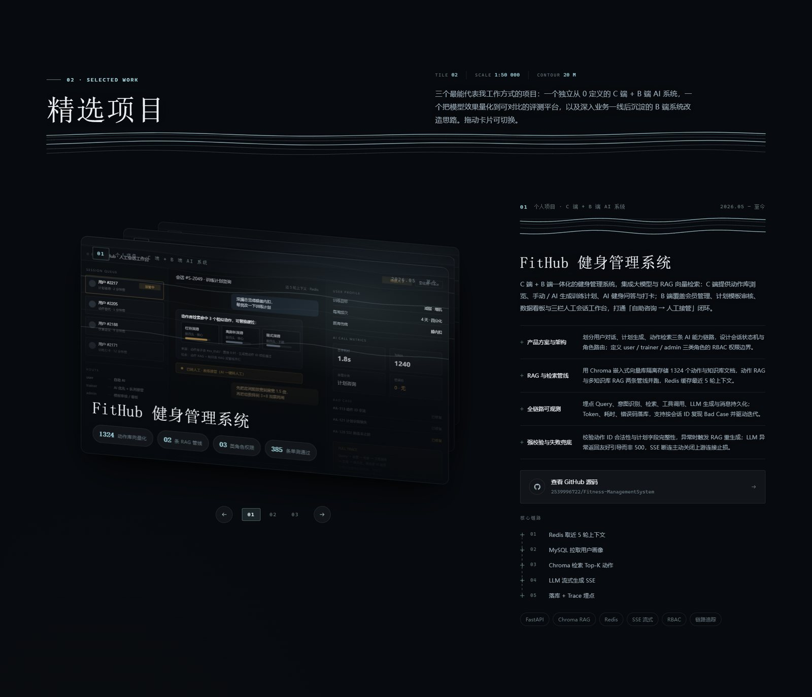
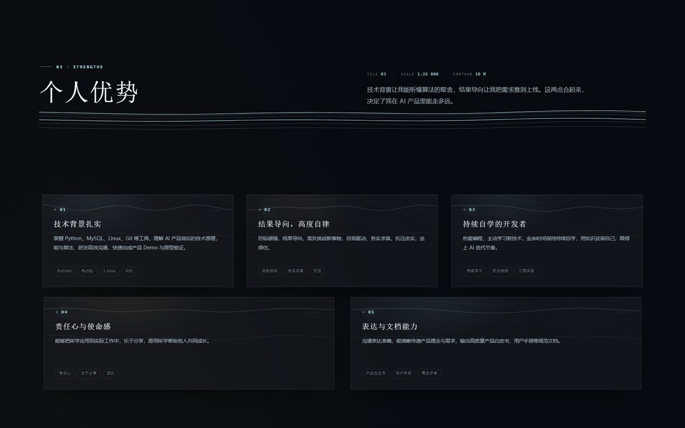
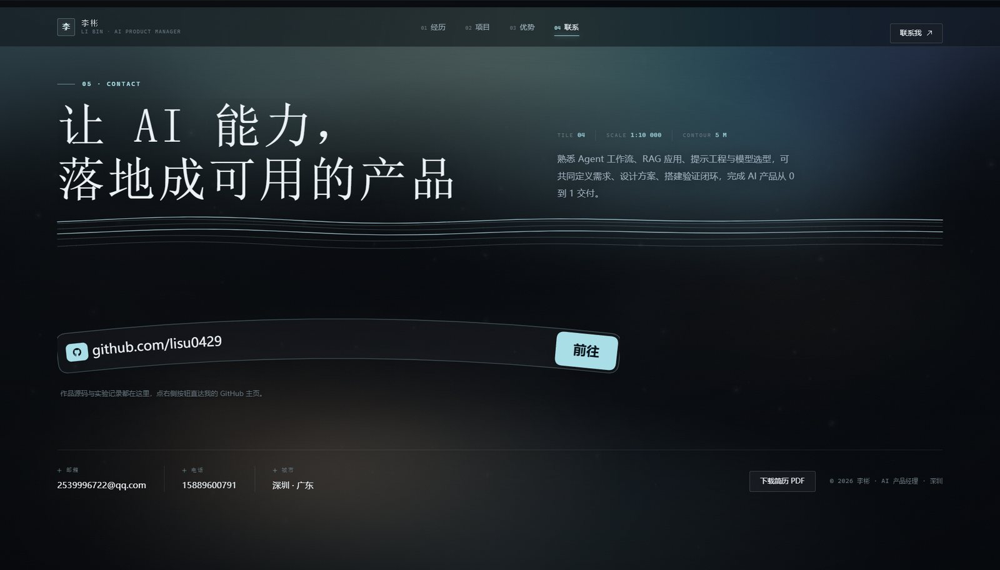
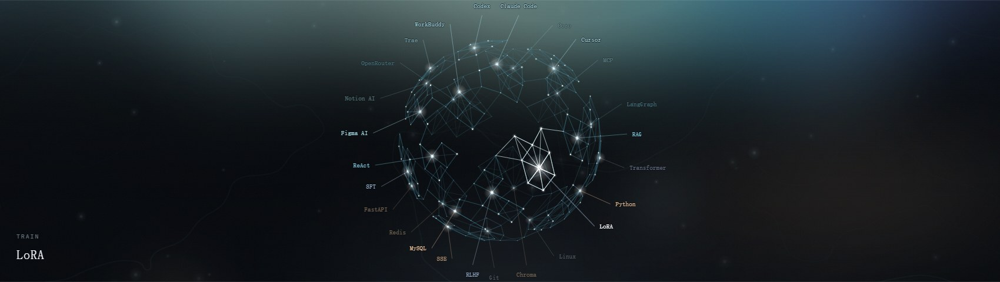

<p align="center">
  <a href="./README.md">简体中文</a> · <b>English</b>
</p>

<!-- README_SYNC: source=working-tree; updated=2026-10-31 -->

<h1 align="center">Li Bin · AI Product Manager Portfolio</h1>

<p align="center">
  A hand-written portfolio site: <b>React 19 + Vite 8</b>, no UI framework, no component-library defaults. The frosted-glass and cartographic look is built entirely from CSS variables, SVG and canvas.
</p>

<p align="center">
  <a href="https://github.com/lisu0429/My-Portfolio/stargazers">
    <b>If this approach is useful to you, a star keeps it handy for you and helps others looking for portfolio ideas find it.</b>
  </a>
</p>

<p align="center">
  <a href="https://github.com/lisu0429/My-Portfolio/stargazers"></a>
  <a href="https://github.com/lisu0429/My-Portfolio/issues"></a>
  <a href="https://github.com/lisu0429/My-Portfolio/commits/main"></a>
  
  
  =22.12" src="https://img.shields.io/badge/Node-%5E20.19%20%7C%20%3E%3D22.12-0b3d4d?style=flat-square&logo=nodedotjs&logoColor=white">
</p>



## What this is

Most portfolios are a résumé with better typography: a short bio, three screenshots, contact details at the bottom. This one tries a little harder — three real projects, a structural view of the skill set and the contact details are folded into one continuous scroll, and **every visual layer says the same thing**: the page is a survey map whose tiles keep zooming in.

| | |
| --- | --- |
| Who it is for | Anyone who needs an AI product manager portfolio, and front-end developers who want to borrow the frosted-glass + contour-line visual system |
| What it solves | Makes "technically grounded AI product manager" visible: not just PRDs, but demos and backend prototypes that actually run |
| What it demonstrates on the technical side | You do not need a UI framework. React 19 + hand-written CSS + canvas / WebGL is enough for a memorable layout, and every animation lives in `src/motion/`, so it is easy to change or delete |
| What it is not | Not a reusable portfolio template: no in-site language switch, no CMS, no admin panel. All copy lives in `src/data/profile.js` |

## Contents

- [Quick start](#quick-start)
- [Page structure](#page-structure)
- [Repository layout](#repository-layout)
- [Editing copy and assets](#editing-copy-and-assets)
- [Design system](#design-system)
- [Self-check scripts](#self-check-scripts)
- [Stack](#stack)
- [Known limitations](#known-limitations)
- [Credits](#credits)
- [License](#license)

## Quick start

**Option 1: double-click `start.cmd`** (Windows, zero setup)

- Checks the Node environment, runs `npm install` on first launch
- If the port is taken, it first checks whether the occupant is this site (opens the browser if so) and otherwise asks before killing it
- Opens the browser when the dev server is ready; the window offers `[S]` to stop the server or `[N]` to exit and leave it running
- Stop at any time with `stop.cmd`, or by pressing `S` in the launcher window
- Logs go to `dev-server.log`

**Option 2: command line**

```bash
npm install
npm run dev      # http://127.0.0.1:5173
npm run build    # output -> dist/
npm run preview  # serve the production build
```

Node is required at `^20.19.0 || >=22.12.0` (a Vite 8 constraint); development here ran on Node 24. The port is fixed at `127.0.0.1:5173` in `vite.config.js`.

## Page structure

Five sections on one scroll, with a persistent navigation in the corner. Every interaction follows one rule: hover brightens, drag rotates, click expands.

| Section | Main components | In one line |
| --- | --- | --- |
| 01 Hero | `Hero.jsx` · `TechText` · `Lanyard` | The name is drawn letter by letter on canvas; letters near the pointer dissolve into vector outlines, with a fog band along the bottom |
| 02 Profile | `About.jsx` · `StarBorder` · `NeuronGlobe` | An ID lanyard you can drag and flip; four stats rendered as a star-lit panel; 25 tools gathered into one colour-coded sphere |
| 03 Selected work | `Projects.jsx` · `CardSwap` | Three cards stacked in 3D, auto-rotating every 7s, pausing on hover of the detail panel, draggable to throw away |
| 04 Strengths | `Strengths.jsx` · `Survey` | Five capability cards; contour terrain sits in the upper half of each and lights up near the pointer |
| 05 Contact | `Contact.jsx` · `CurvedInput` | A curved input bar carries the GitHub handle, with text laid out on a real arc (`<textPath>`) |

### Profile



### Selected work



### Strengths



### Contact



## Repository layout

```text
.
├─ index.html                 # async font loading + preload of the Manrope 800 subset
├─ vite.config.js             # port fixed at 127.0.0.1:5173
├─ start.cmd / stop.cmd       # one-click start / stop on Windows
├─ public/
│  ├─ media/                  # hero.mp4, id-card-back.jpg, three project images (SVG)
│  ├─ fonts/                  # manrope-latin-800.woff2 (13.6KB, self-hosted)
│  ├─ favicon.svg
│  └─ resume.pdf              # target of the "download résumé" button
├─ src/
│  ├─ data/profile.js         # the single source of all copy and project data
│  ├─ components/             # page sections + visual components (Survey / StarBorder / NeuronGlobe …)
│  ├─ motion/                 # GSAP + ScrollTrigger, the single source of animation truth
│  ├─ styles/                 # tokens.css (palette / fonts / scale) + base.css
│  └─ assets/headshot.webp    # headshot (transparent portrait)
├─ scripts/                   # Playwright screenshots and interaction self-checks
├─ docs/                      # design system notes + the images used by this README
├─ preview/                   # screenshots produced by the self-check scripts (not committed)
└─ _pdfpages/                 # 300dpi render of the résumé's first page, for manual comparison only
```

## Editing copy and assets

**Copy**: there is exactly one entry point — `src/data/profile.js`. Editing that file updates every section.

| Export | Controls |
| --- | --- |
| `profile` | Name, city, school, email, phone, GitHub handle, résumé path |
| `hero` | Hero name, three corner labels, one-line pitch, four meta slots, two buttons |
| `stats` | The four profile stats (value, note, number of lit ticks) |
| `about` / `timeline` | Two intro paragraphs, contact rows, three timeline entries |
| `projects` | Three project cards: summary, responsibility breakdown, metrics, core path, tags, repo link |
| `strengths` | Five capability cards |
| `contact` | Contact headline, lead paragraph, channels |
| `survey` | The map-tile readouts in section headers (TILE / SCALE / CONTOUR / GRID / DATUM) |
| `tools` / `toolGroups` | The 25 tools on the constellation and the 5 cluster colours |

**Assets**:

| Asset | Path | Spec |
| --- | --- | --- |
| Hero background video | `public/media/hero.mp4` | 1920×1080, 10s loop, muted (H.264 + faststart, currently 1.4MB) |
| ID card back | `public/media/id-card-back.jpg` | 1024×1440, shown when the lanyard card is flipped |
| Project images | `public/media/project-*.svg` | Replace with real screenshots using the same base name plus `.png` / `.jpg`, then update `image` in `profile.js` |
| Headshot | `src/assets/headshot.webp` | 880×1100 transparent portrait, used as the front of the lanyard card |
| Résumé PDF | `public/resume.pdf` | Target of the "download résumé" button |
| Hero font | `public/fonts/manrope-latin-800.woff2` | Manrope 800 Latin subset, so the hero does not wait on a CDN |

## Design system

Four visual languages share one base: deep night blue `#070A0E`, mist cyan `#A9DEE8`, warm light `#E8BE96`. The details, the exact parameters and the bugs that shaped them live in **[Design system notes](./docs/design-system.md)**; this README keeps only the conclusions:

- **Fog and glass**: the whole site uses one glass material, `.glass` (4.2% white fill + `backdrop-filter: blur(22px)`). Navigation, project cards and capability cards share the class, so one edit changes all of them.
- **Cartographic language**: the backdrop is React Bits' `<Topography />`, and the content sections reuse its metaphor — contour rules, survey crosses, elevation ticks and map-tile readouts. The four sections are four tiles of one map, each at a larger scale.
- **Tool constellation**: React Bits Pro's paid component was out of reach, so this is an equivalent built from the public parameter table: 240 stars laid out on a sphere, 25 tools pinned onto it, drag applies angular velocity directly, click sends a pulse across the surface.



## Self-check scripts

```bash
npm run dev                          # start the dev server first

node scripts/shoot.mjs               # capture every section into preview/, check overflow, reduced-motion, console errors
node scripts/shoot.mjs 1440 1280     # also capture the given viewport widths
node scripts/check-interactions.mjs  # constellation: hover readout, drag spin, click pulse, frame rate, reduced-motion freeze
node scripts/check-contact.mjs       # curved contact bar: does the button / Enter really open GitHub
```

The scripts need `playwright-core` and try three locations in order: the `CODEX_NODE_MODULES` environment variable, the bundled Codex runtime, and the local `node_modules`:

```bash
CODEX_NODE_MODULES=/path/to/node_modules node scripts/shoot.mjs
```

`scripts/` only serves asset generation and self-checks; it takes no part in the build:

```bash
node scripts/gen-hero-video.mjs public/media/hero-loop.webm   # render the hero background loop with Playwright
node scripts/gen-headshot.mjs                                 # re-cut the headshot (source image path is hard-coded at the top of the script)
```

## Stack

| Dependency | Version | Role here |
| --- | --- | --- |
| React / React DOM | 19.3.1 | Page structure; `StrictMode` double-mounting is the source of a few of the bugs below |
| Vite | 8.3.5 | Dev server and build, with no extra plugins beyond `@vitejs/plugin-react` |
| GSAP | 3.15.0 | Hero opening, scroll choreography, media parallax |
| three.js | 0.187.0 | Used only by the ID lanyard `<Lanyard />` |
| Hand-written CSS | — | CSS Modules + `tokens.css` variables; no Tailwind, no UI library |

`dist/` and `node_modules/` are not committed.

## Known limitations

- **Desktop first.** Breakpoints cover 1400 / 1280 / 1200 / 1100 / 900 / 760, so narrow screens work, but there is no touch-specific pass: dragging the project cards, the constellation and the lanyard all assume a precise pointer.
- **Decorative layers need WebGL and Canvas** (aurora, contour backdrop, tool constellation, star panel, hero name). With hardware acceleration off or WebGL unavailable these layers simply do not draw; the text content stays readable.
- **Fonts are split in two**: the hero name uses a self-hosted subset, while the rest of the Latin and all Chinese text still come from Google Fonts. Without network access the first screen still renders, with fallback glyphs.
- **The self-check scripts point at a local Codex runtime path by default**. On another machine, set `CODEX_NODE_MODULES` or install `playwright-core` locally.
- **No SSR and no automated deployment**: it is a plain static site. Run `npm run build` and host `dist/` anywhere; there is no CI in this repository.
- **The bundle is not split**: `npm run build` emits a 493KB main chunk and a 591KB three.js chunk (170KB / 152KB gzipped), and Vite warns about chunks over 500KB. Reducing that means dynamic imports per section.

## Credits

Some visual components come from the open-source project [React Bits](https://reactbits.dev/) (`Aurora` / `Topography` / `StarBorder` / `Lanyard` / `CardSwap` / `TechText` / `CurvedInput`); those components and assets remain under their own licenses. The star-lit stat panel and the tool constellation are equivalent implementations built from their public parameter tables. Animation relies on [GSAP](https://gsap.com/), and the 3D lanyard relies on [three.js](https://threejs.org/).

## License

This repository currently has **no `LICENSE` file**: the source is publicly readable, but nobody is granted the right to copy, modify or redistribute the code or assets in it. If you want to reuse a specific piece, open an [issue](https://github.com/lisu0429/My-Portfolio/issues) first and I will give a clear answer instead of leaving an implied-MIT grey area. Third-party components and fonts follow their own licenses.

---

If this site gave you an idea — the way the glass layers stack, or turning a portfolio into a survey map — star it and keep it. If something breaks or you want to talk AI product work, open an [issue](https://github.com/lisu0429/My-Portfolio/issues).

<p align="center">
  <a href="./README.md">中文版本</a>
</p>
